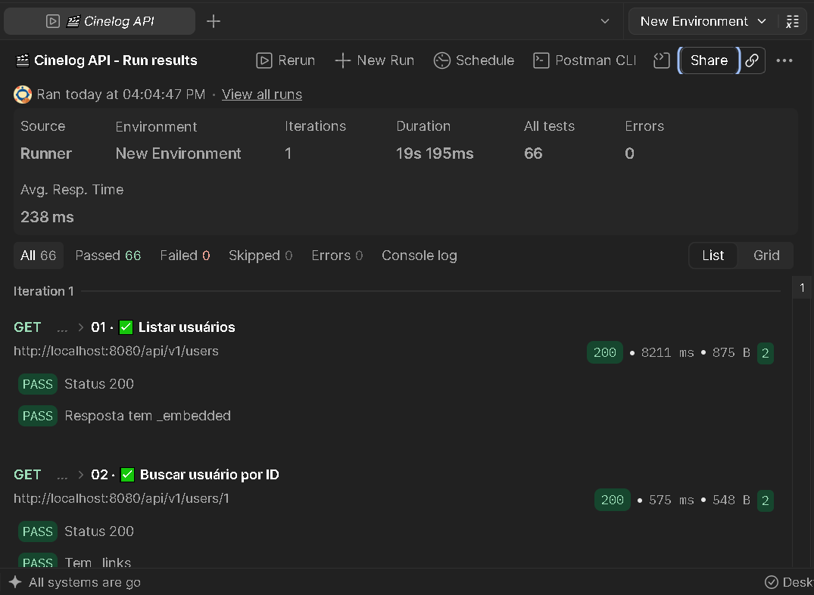

# 🎬 Cinelog API

> **API REST para catalogação de filmes e gerenciamento de watchlists pessoais.**

A **Cinelog API** permite cadastrar filmes, associá-los a gêneros e armazenar informações detalhadas (sinopse, orçamento, país de origem). Cada usuário pode criar listas pessoais de filmes (*watchlists*) e acompanhar o status de cada item (**QUERO_VER / VENDO / VISTO / ABANDONADO**), com nota opcional de 1 a 10.

A API implementa **HATEOAS**, oferecendo navegabilidade entre os recursos via hiperlinks retornados em cada resposta.

---

## 📑 Índice

- [Visão geral](#-visão-geral)
- [Stack técnica](#-stack-técnica)
- [Arquitetura](#-arquitetura)
- [Recursos disponíveis](#-recursos-disponíveis)
- [Como executar](#-como-executar)
- [Documentação interativa (Swagger)](#-documentação-interativa-swagger)
- [Endpoints principais](#-endpoints-principais)
- [Paginação](#-paginação)
- [HATEOAS](#-hateoas)
- [Tratamento de erros](#-tratamento-de-erros)
- [Rate Limit (Token Bucket)](#-rate-limit-token-bucket)
- [CORS](#-cors)
- [Idempotência](#-idempotência)
- [Versionamento via header](#-versionamento-via-header)
- [Exemplo de fluxo completo](#-exemplo-de-fluxo-completo)
- [Estrutura do projeto](#-estrutura-do-projeto)
- [Autor](#-autor)

---

## 📖 Visão geral

A Cinelog API foi projetada para servir como back-end de uma aplicação de gerenciamento de filmes e listas pessoais. Ela cobre **6 recursos principais**:

| Recurso | Rota base | Descrição |
|---|---|---|
| **Usuários** | `/users` | Donos das watchlists |
| **Gêneros** | `/genres` | Categorias de filmes (ação, drama, ficção científica...) |
| **Filmes** | `/movies` | Catálogo principal |
| **Detalhes de Filmes** | `/movie-details` | Informações estendidas (1:1 com filme) |
| **Watchlists** | `/watchlists` | Listas pessoais de cada usuário |
| **Itens de Watchlist** | `/watchlist-items` | Filmes dentro de uma watchlist (com status e nota) |

---

## 🛠️ Stack técnica

| Camada | Tecnologia |
|---|---|
| **Linguagem** | Java 17 |
| **Framework** | Spring Boot 4.1.1 |
| **Persistência** | Spring Data JPA + Hibernate |
| **Banco de dados** | H2 (em memória) |
| **Documentação** | SpringDoc OpenAPI 3.1 (Swagger UI) |
| **Hipermídia** | Spring HATEOAS |
| **Validação** | Bean Validation (Jakarta) |
| **Rate limit** | Bucket4j (algoritmo Token Bucket) |
| **Build** | Maven |
| **Testes** | Spring Boot Starter Test |

---

## 🏗️ Arquitetura

A API segue **arquitetura em camadas**, com separação clara de responsabilidades:

```
┌──────────────────┐
│    Controller    │  ← Recebe requisições HTTP, delega ao Service
├──────────────────┤
│      DTO         │  ← Contratos de entrada e saída (Request / Response)
├──────────────────┤
│     Service      │  ← Regras de negócio, orquestração
├──────────────────┤
│    Repository    │  ← Acesso ao banco de dados (Spring Data JPA)
├──────────────────┤
│     Entity       │  ← Mapeamento objeto-relacional (JPA/Hibernate)
└──────────────────┘
       ↑
   Exception         ← Exceções customizadas + @RestControllerAdvice
```

**Decisões arquiteturais:**
- **DTOs** separados das entidades para não expor o modelo de banco.
- **Tratamento centralizado de erros** com `@RestControllerAdvice` (formato padronizado).
- **HATEOAS** para navegabilidade entre recursos.
- **Bean Validation** nos DTOs de entrada.
- **Rate limit** por IP com Token Bucket e **CORS** restrito a origens específicas.
- **Idempotência** nos `POST` pelo cabeçalho `X-Idempotency-Key` (`IdempotencyService`).
- **Versionamento via cabeçalho** `X-API-Version`: as rotas não carregam a versão (`/api/users`).
- **Paginação** em todas as listagens.

---

## 📦 Recursos disponíveis

### 👤 Usuários — `/users`
Donos das watchlists.

### 🎭 Gêneros — `/genres`
Categorias de filmes, com nome único (validação de duplicata).

### 🎬 Filmes — `/movies`
Catálogo principal. Cada filme pode ter **vários gêneros** (relacionamento muitos-para-muitos).

### 📝 Detalhes de Filmes — `/movie-details`
Informações estendidas: sinopse, orçamento, país de origem, idioma. Relacionamento **1:1** com filme.

### 📋 Watchlists — `/watchlists`
Listas pessoais criadas por cada usuário.

### 🎞️ Itens de Watchlist — `/watchlist-items`
Filmes adicionados a uma watchlist, com **status** (`QUERO_VER`, `VENDO`, `VISTO`, `ABANDONADO`) e **nota** (1 a 10).

---

## 🚀 Como executar

### Pré-requisitos

- **JDK 17+**
- **Maven** (ou use o `mvnw` incluso)

### Passos

```bash
# 1. Clone o repositório
git clone https://github.com/seu-usuario/cinelog-api.git
cd cinelog-api

# 2. Compile o projeto
./mvnw clean install

# 3. Execute a aplicação
./mvnw spring-boot:run
```

A API estará disponível em: **`http://localhost:8080`**

### Console H2

Para inspecionar o banco de dados em memória:

- **URL:** `http://localhost:8080/h2-console`
- **JDBC URL:** `jdbc:h2:mem:testdb`
- **Usuário:** `sa`
- **Senha:** *(vazio)*

> ℹ️ O banco é **em memória**. Os dados são reiniciados a cada execução e populados a partir do arquivo `data.sql`.

---

## 📚 Documentação interativa (Swagger)

A documentação completa está disponível em:

```
http://localhost:8080/swagger-ui.html
```

O Swagger UI permite **explorar e testar todos os endpoints** diretamente no navegador, com:

- Descrição detalhada da API
- Exemplos de requisições e respostas
- Todos os códigos de status HTTP possíveis
- Links HATEOAS em cada resposta

---

## 🛣️ Endpoints principais

### 👤 Usuários

| Método | Rota | Descrição |
|---|---|---|
| `GET` | `/api/users` | Lista todos os usuários |
| `GET` | `/api/users/{id}` | Busca usuário por ID |
| `POST` | `/api/users` | Cria novo usuário |
| `PUT` | `/api/users/{id}` | Atualiza usuário |
| `DELETE` | `/api/users/{id}` | Remove usuário |
| `GET` | `/api/users/{id}/watchlists` | Watchlists do usuário |

### 🎭 Gêneros

| Método | Rota | Descrição |
|---|---|---|
| `GET` | `/api/genres` | Lista gêneros (paginado) |
| `GET` | `/api/genres/{id}` | Busca gênero por ID |
| `GET` | `/api/genres/search?nome=...` | Busca por nome (parcial) |
| `POST` | `/api/genres` | Cria gênero |
| `PUT` | `/api/genres/{id}` | Atualiza gênero |
| `DELETE` | `/api/genres/{id}` | Remove gênero |
| `GET` | `/api/genres/{id}/movies` | Filmes do gênero |

### 🎬 Filmes

| Método | Rota | Descrição |
|---|---|---|
| `GET` | `/api/movies` | Lista filmes (paginado) |
| `GET` | `/api/movies/{id}` | Busca filme por ID |
| `GET` | `/api/movies/search?titulo=...` | Busca por título |
| `POST` | `/api/movies` | Cria filme |
| `PUT` | `/api/movies/{id}` | Atualiza filme |
| `DELETE` | `/api/movies/{id}` | Remove filme |
| `GET` | `/api/movies/{id}/details` | Detalhes do filme |

### 📝 Detalhes de Filmes

| Método | Rota | Descrição |
|---|---|---|
| `GET` | `/api/movie-details` | Lista detalhes (paginado) |
| `GET` | `/api/movie-details/{id}` | Busca detalhes por ID |
| `GET` | `/api/movie-details/search?paisOrigem=...` | Busca por país |
| `POST` | `/api/movie-details` | Cria detalhes |
| `PUT` | `/api/movie-details/{id}` | Atualiza (substituição completa) |
| `PATCH` | `/api/movie-details/{id}` | Atualiza (parcial) |
| `DELETE` | `/api/movie-details/{id}` | Remove detalhes |

### 📋 Watchlists

| Método | Rota | Descrição |
|---|---|---|
| `GET` | `/api/watchlists` | Lista watchlists (paginado) |
| `GET` | `/api/watchlists/{id}` | Busca watchlist por ID |
| `POST` | `/api/watchlists` | Cria watchlist |
| `PUT` | `/api/watchlists/{id}` | Atualiza watchlist |
| `DELETE` | `/api/watchlists/{id}` | Remove watchlist |
| `GET` | `/api/watchlists/{id}/items` | Itens da watchlist (filtro `?status=`) |

### 🎞️ Itens de Watchlist

| Método | Rota | Descrição |
|---|---|---|
| `GET` | `/api/watchlist-items` | Lista itens (paginado) |
| `GET` | `/api/watchlist-items/{id}` | Busca item por ID |
| `POST` | `/api/watchlist-items` | Adiciona filme à watchlist |
| `PUT` | `/api/watchlist-items/{id}` | Atualiza item |
| `DELETE` | `/api/watchlist-items/{id}` | Remove item |

---

## 📄 Paginação

Endpoints que retornam listas são **paginados**. Parâmetros aceitos:

| Parâmetro | Descrição | Padrão |
|---|---|---|
| `page` | Número da página (começa em 0) | `0` |
| `size` | Itens por página | `20` |
| `sort` | Campo e direção (`campo,asc` ou `campo,desc`) | — |

**Exemplo:**
```
GET /api/movies?page=0&size=10&sort=titulo,asc
```

**Resposta (formato `PagedModel` do HATEOAS):**
```json
{
  "_embedded": {
    "movieResponseList": [ /* filmes */ ]
  },
  "page": {
    "size": 10,
    "totalElements": 4,
    "totalPages": 1,
    "number": 0
  },
  "_links": {
    "self":  { "href": ".../movies?page=0&size=10" },
    "first": { "href": "..." },
    "last":  { "href": "..." }
  }
}
```

---

## 🔗 HATEOAS

Toda resposta de **sucesso** inclui um bloco `_links` com URLs para navegação entre os recursos:

| Link | Significado |
|---|---|
| `self` | O próprio recurso |
| `all-...` | A coleção completa |
| `update` / `delete` | Ações possíveis |
| Recursos relacionados | Ex.: `movie`, `watchlist`, `items`, `details` |

**Exemplo — `GET /api/movies/1`:**
```json
{
  "_links": {
    "self":       { "href": "http://localhost:8080/api/movies/1" },
    "all-movies": { "href": "http://localhost:8080/api/movies" },
    "update":     { "href": "http://localhost:8080/api/movies/1" },
    "delete":     { "href": "http://localhost:8080/api/movies/1" },
    "details":    { "href": "http://localhost:8080/api/movies/1/details" }
  },
  "id": 1,
  "titulo": "Interestelar",
  "anoLancamento": 2014,
  "duracao": 169,
  "classificacaoIndicativa": "12",
  "generos": [ /* ... */ ]
}
```

Com isso, o cliente pode **descobrir dinamicamente** os recursos relacionados, sem precisar conhecer as URLs de antemão.

---

## 🚨 Tratamento de erros

Todos os erros retornam o **mesmo formato padronizado**:

```json
{
  "timestamp": "2026-10-04T14:55:57",
  "status": 404,
  "errorMessage": "NOT_FOUND",
  "message": "Filme não encontrado com o ID: 999",
  "path": "/api/movies/999"
}
```

Nos erros de **validação** (`400`), a resposta traz também a lista `errors` com **todos** os campos inválidos de uma vez:

```json
{
  "timestamp": "2026-10-04T14:55:57",
  "status": 400,
  "errorMessage": "BAD_REQUEST",
  "message": "Erro de validação: 2 problema(s) encontrado(s). Veja os detalhes em 'errors'.",
  "path": "/api/users",
  "errors": [
    "email: O email deve ser um endereço válido",
    "name: O nome não pode estar em branco"
  ]
}
```

### Códigos HTTP utilizados

| Código | Significado | Quando acontece |
|---|---|---|
| `200` | OK | Requisição bem-sucedida |
| `201` | Created | Recurso criado (com header `Location`) |
| `204` | No Content | Recurso deletado (sem corpo) |
| `400` | Bad Request | Erros de validação, JSON mal formado, parâmetro com tipo errado (`/users/abc`) ou ausente, versão da API inexistente, regra de negócio |
| `403` | Forbidden | Requisição de navegador vinda de uma origem não autorizada no CORS |
| `404` | Not Found | Recurso ou rota não encontrados |
| `405` | Method Not Allowed | Método HTTP não aceito pela rota (header `Allow` informa os aceitos) |
| `409` | Conflict | Duplicata ou FK em uso |
| `415` | Unsupported Media Type | Corpo enviado em formato diferente de `application/json` |
| `422` | Unprocessable Entity | `X-Idempotency-Key` reutilizada com um corpo diferente |
| `429` | Too Many Requests | Limite de requisições excedido (header `Retry-After`) |
| `500` | Internal Server Error | Erro interno não previsto (o detalhe completo fica só no log do servidor) |

### Como a validação e os erros são tratados

- **Bean Validation** nos DTOs de entrada (`@NotBlank`, `@Size`, `@Email`, `@Min`, `@Max`, `@Positive`...), acionado por `@Valid` nos controllers.
- **`GlobalExceptionHandler`** (`@RestControllerAdvice`) captura as exceções de toda a aplicação e devolve sempre o formato `APIError`.
- Exceções customizadas: `ResourceNotFoundException` (404), `ConflictException` (409), `BusinessException` (400), `UnprocessableRequestException` (422) e `TooManyRequestsException` (429).

---

## 🚦 Rate Limit (Token Bucket)

A API limita as requisições **por IP** com o algoritmo **Token Bucket** (biblioteca Bucket4j):

- Cada IP tem um **balde** que começa cheio (padrão: **100 tokens**).
- Cada requisição **gasta 1 token**.
- O balde é **reabastecido aos poucos** (padrão: 100 tokens por minuto).
- Com o balde vazio, a API responde **`429 Too Many Requests`** com o cabeçalho **`Retry-After`**.
- O limite vale para as rotas `/api/**`. Requisições `OPTIONS` (preflight do CORS) não gastam tokens.

| Cabeçalho de resposta | Quando aparece | Significado |
|---|---|---|
| `X-RateLimit-Limit` | Em toda resposta | Tamanho máximo do balde |
| `X-RateLimit-Remaining` | Em toda resposta | Tokens que ainda restam |
| `Retry-After` | Só no `429` | Segundos de espera antes de tentar de novo |

**Exemplo de resposta `429`:**
```
HTTP/1.1 429
Retry-After: 1
X-RateLimit-Limit: 100
X-RateLimit-Remaining: 0
```
```json
{
  "timestamp": "2026-10-04T14:55:57",
  "status": 429,
  "errorMessage": "TOO_MANY_REQUESTS",
  "message": "Limite de requisições excedido. Tente novamente em 1 segundo(s).",
  "path": "/api/genres"
}
```

**Configuração** (`application.properties`):

```properties
# tamanho do balde (máximo de requisições em rajada)
rate-limit.capacity=100
# tokens devolvidos a cada período
rate-limit.refill-tokens=100
# duração do período, em segundos
rate-limit.refill-seconds=60
```

**Como demonstrar o 429:** troque `rate-limit.capacity` e `rate-limit.refill-tokens` para `5`, reinicie a aplicação e dispare várias requisições seguidas.

```bash
# Linux / macOS / Git Bash
for i in $(seq 1 10); do curl -s -o /dev/null -w "%{http_code}\n" http://localhost:8080/api/genres; done

# PowerShell (Windows)
1..10 | ForEach-Object { curl.exe -s -o NUL -w "%{http_code}`n" http://localhost:8080/api/genres }

# Ver os cabeçalhos de uma resposta
curl -i http://localhost:8080/api/genres
```

---

## 🌐 CORS

O CORS permite que **front-ends rodando em outra origem** (protocolo + domínio + porta) chamem a API pelo navegador.

| Item | Configuração |
|---|---|
| **Origens permitidas** | Somente as de `cors.allowed-origins` (padrão: `http://localhost:3000`, `http://localhost:5173`, `http://localhost:4200`). **Não** usa `*` |
| **Métodos permitidos** | `GET`, `POST`, `PUT`, `PATCH`, `DELETE`, `OPTIONS` |
| **Cabeçalhos permitidos** | `Content-Type`, `Accept`, `X-API-Key`, `X-Idempotency-Key`, `X-API-Version` |
| **Cabeçalhos legíveis pelo front-end** | `Location`, `Retry-After`, `X-RateLimit-Limit`, `X-RateLimit-Remaining`, `Idempotent-Replayed` |
| **Credenciais (cookies)** | Desativadas |
| **Cache do preflight** | 1 hora |

Para liberar outro front-end, altere a propriedade:

```properties
cors.allowed-origins=http://localhost:3000,https://meu-front.com
```

**Testando com curl:**

```bash
# Origem permitida: a resposta traz Access-Control-Allow-Origin
curl -i -X OPTIONS http://localhost:8080/api/movies \
  -H "Origin: http://localhost:3000" \
  -H "Access-Control-Request-Method: POST"

# Origem NÃO permitida: 403 Invalid CORS request
curl -i -X OPTIONS http://localhost:8080/api/movies \
  -H "Origin: http://site-desconhecido.com" \
  -H "Access-Control-Request-Method: POST"
```

> ℹ️ O CORS é uma proteção **do navegador**. Postman, curl e o Swagger UI (que roda na mesma origem da API) não são afetados.

---

## 🔁 Idempotência

Uma operação é **idempotente** quando repeti-la tem o mesmo efeito de fazê-la uma vez. `GET`, `PUT` e `DELETE` já são idempotentes pelo próprio HTTP; o `POST` não é. Se o cliente reenviar um `POST` (clique duplo, retry após timeout), o registro seria criado duas vezes.

Por isso todos os `POST` aceitam o cabeçalho opcional **`X-Idempotency-Key`**, com um valor único gerado pelo cliente (ex.: um UUID):

| Situação | Resultado |
|---|---|
| Chave nova | Executa normalmente e **guarda a resposta** por 24 horas |
| Mesma chave e **mesmo corpo** | **Não cria nada.** Devolve a resposta original (`201`, `Location` e corpo) com o cabeçalho `Idempotent-Replayed: true` |
| Mesma chave e **corpo diferente** | `422 Unprocessable Entity` (a chave já identifica outra operação) |
| Sem o cabeçalho | Comportamento normal |

- Duas requisições simultâneas com a mesma chave são serializadas: a segunda espera a primeira e recebe a mesma resposta.
- Se a primeira tentativa falhar (validação, 404, 409...), nada é guardado e o cliente pode tentar de novo com a mesma chave.
- As respostas ficam em memória (como o banco H2, somem ao reiniciar a aplicação).

**Testando** (Git Bash/Linux/macOS; no Postman basta adicionar o cabeçalho na aba *Headers*):

```bash
# 1ª vez: 201 Created
curl -i -X POST http://localhost:8080/api/genres \
  -H "Content-Type: application/json" \
  -H "X-Idempotency-Key: 7c9e6679-7425-40de-944b-e07fc1f90ae7" \
  -d '{"nome": "Cyberpunk"}'

# Mesma chave e mesmo corpo: 201 com o MESMO id e "Idempotent-Replayed: true" (nada foi criado)
curl -i -X POST http://localhost:8080/api/genres \
  -H "Content-Type: application/json" \
  -H "X-Idempotency-Key: 7c9e6679-7425-40de-944b-e07fc1f90ae7" \
  -d '{"nome": "Cyberpunk"}'

# Mesma chave e corpo DIFERENTE: 422 Unprocessable Entity
curl -i -X POST http://localhost:8080/api/genres \
  -H "Content-Type: application/json" \
  -H "X-Idempotency-Key: 7c9e6679-7425-40de-944b-e07fc1f90ae7" \
  -d '{"nome": "Western"}'
```

Sem o cabeçalho, repetir o primeiro comando devolveria `409 Conflict` (gênero duplicado).

---

## 🔖 Versionamento via header

A versão da API é informada no cabeçalho **`X-API-Version`**, e **não na URL**. As rotas são sempre `/api/users`, `/api/movies`... e o cliente escolhe a versão a cada requisição. Assim, a URL de um recurso nunca muda quando a API evolui.

O recurso usa o suporte nativo a versionamento do Spring Framework 7 (`ApiVersionConfigurer`, configurado no `WebConfig`):

| Requisição | Resultado |
|---|---|
| Sem o cabeçalho | Usa a versão padrão (`1`) |
| `X-API-Version: 1` | Versão 1 |
| `X-API-Version: 99` (inexistente) ou `abc` (formato inválido) | `400 Bad Request` no formato `APIError` |

```bash
# Versão 1 informada no cabeçalho
curl -i http://localhost:8080/api/genres -H "X-API-Version: 1"

# Sem o cabeçalho: usa a versão padrão
curl -i http://localhost:8080/api/genres

# Versão inexistente: 400 Bad Request
curl -i http://localhost:8080/api/genres -H "X-API-Version: 99"
```

```json
{
  "timestamp": "2026-10-04T14:55:57",
  "status": 400,
  "errorMessage": "BAD_REQUEST",
  "message": "Versão da API não suportada: '99'. Informe no cabeçalho X-API-Version uma das versões disponíveis: 1.",
  "path": "/api/genres"
}
```

**Como lançar uma versão 2:** inclua `"2"` em `SUPPORTED_API_VERSIONS` (`WebConfig`) e mapeie o endpoint novo com o atributo `version`. Os endpoints sem `version` continuam atendendo todas as versões, e quem pede a versão 2 recebe o método marcado com `version = "2"`:

```java
@GetMapping(value = "/movies/{id}", version = "2")
public ResponseEntity<...> getMovieV2(@PathVariable long id) { ... }
```

---

## 🧪 Exemplo de fluxo completo

**Cenário:** criar um filme e adicioná-lo a uma watchlist.

```bash
# 1. Criar um filme
curl -X POST http://localhost:8080/api/movies \
  -H "Content-Type: application/json" \
  -d '{
    "titulo": "Duna",
    "anoLancamento": 2021,
    "duracao": 155,
    "classificacaoIndicativa": "14",
    "genreIds": [1, 3]
  }'

# → 201 Created
# → Location: /api/movies/4
# → _links: self, all-movies, details

# 2. Adicionar o filme a uma watchlist
curl -X POST http://localhost:8080/api/watchlist-items \
  -H "Content-Type: application/json" \
  -d '{
    "watchlistId": 1,
    "movieId": 4,
    "status": "QUERO_VER"
  }'

# → 201 Created
# → _links: self, watchlist, movie

# 3. Consultar os itens da watchlist
curl http://localhost:8080/api/watchlists/1/items?status=QUERO_VER

# → 200 OK (PagedModel com links HATEOAS)
```

---

## 📮 Coleção do Postman



Para testar a API rapidamente, importe a coleção na pasta `postman/`...

## 📂 Estrutura do projeto

```
cinema-service/
├── src/main/java/com/cinelog/api/
│   ├── Configuration/       # Configurações (OpenAPI, CORS, rate limit, versionamento)
│   ├── Controllers/         # Endpoints REST
│   ├── DTO/                 # Data Transfer Objects (Request/Response)
│   ├── Entity/              # Entidades JPA
│   ├── Exception/           # Exceções customizadas + handler global
│   ├── Repository/          # Interfaces Spring Data JPA
│   └── Service/             # Regras de negócio
├── src/main/resources/
│   ├── application.properties
│   └── data.sql             # Dados iniciais (seed)
└── pom.xml
```

---

## 🤝 Contribuições

Este é um **projeto acadêmico**. Sugestões e melhorias são bem-vindas via *issues* ou *pull requests*.

---

## 📄 Licença

Distribuído sob a licença **MIT**. Veja [`LICENSE`](LICENSE) para mais informações.

---

## 👨‍💻 Autor

**Tiago Antunes**

- GitHub: [@tiagoantunes](https://github.com/TiagoAntunes-Dev)
- Email: tiagoantunes1974@gmail.com

---

<p align="center">
  Feito com ☕ e Spring Boot
</p>

